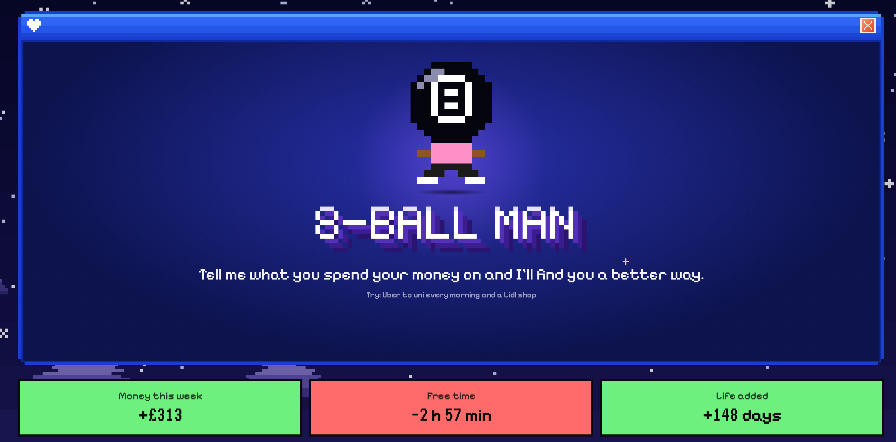
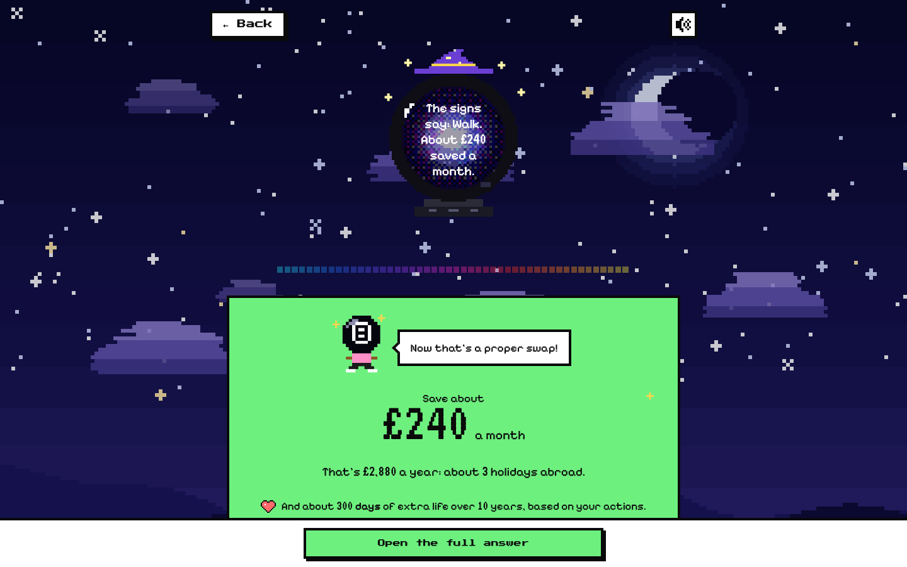
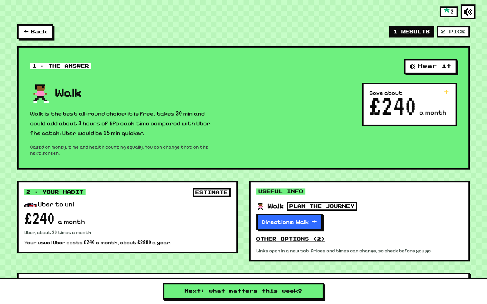
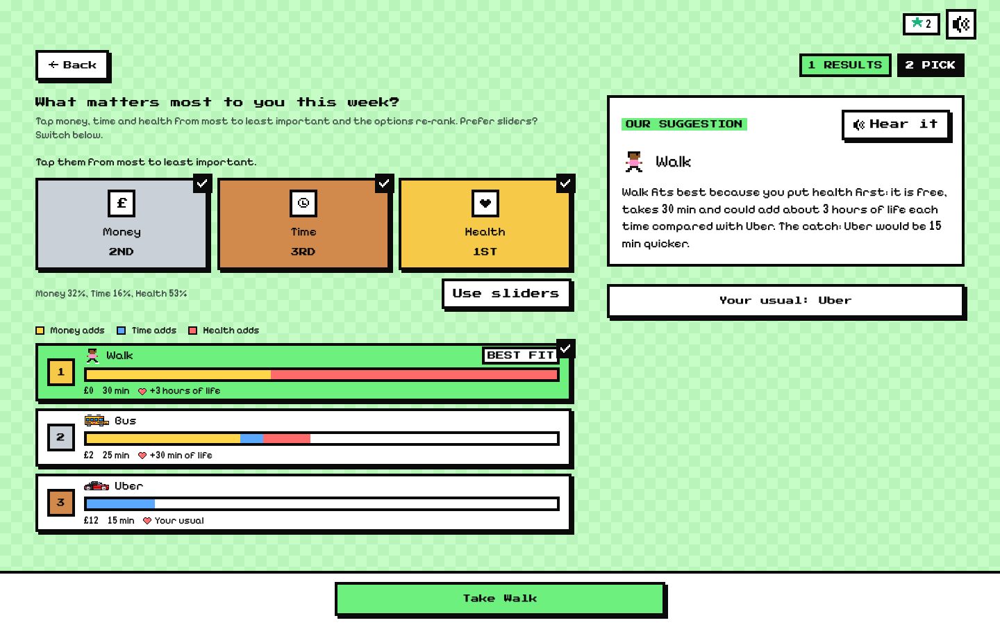
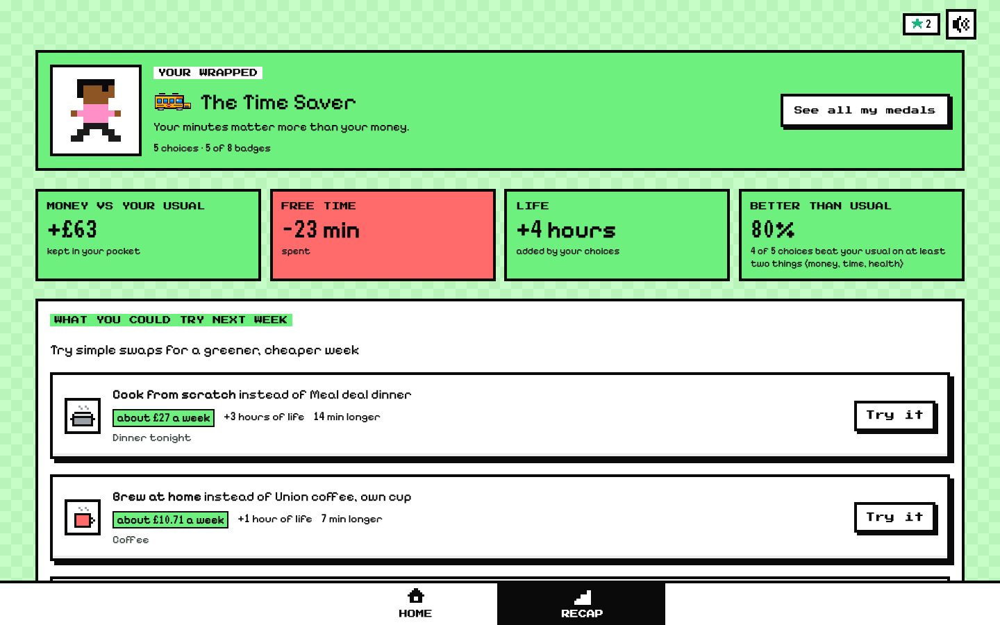
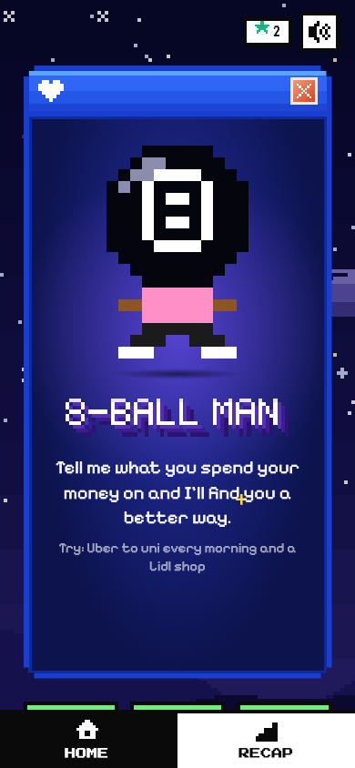

# 8-ball Man
A magical 8-ball that you speak to, and it finds you the best solutions based on cost, the time spent, and also your health.

Built at HackTheBurgh for the Lloyds "Smart Cost of Living" brief: it helps students see what an everyday choice really costs in **money, time and health**, and nudges them towards a better swap.

<p align="center">
  
</p>

## How does it work?
Faster-Whisper model used for speech inference, then transcript passed onto Qwen 3.8 for processing. Then recommendations are provided, with links to further resources.

1. **Tell the ball** what you spend on, by voice or typing ("I get an Uber to uni every morning and a Lidl shop"). Whisper turns speech into text.
2. **Qwen prices it.** It splits the sentence into habits, finds your usual option plus two realistic alternatives, and estimates cost, time and a health score for each. If the request is too vague it asks one short question; if the amount is far too big to judge (a house) it says so instead of guessing.
3. **You get an answer first.** The saving, what it could buy you in a year, and what it does for your life expectancy, spoken back by the character (Piper, or ElevenLabs if you add a key).
4. **Say what matters this week.** Rank money, time and health with one tap each (or sliders) and the options re-order live.
5. **Pick one**, see what you gained, earn medals, and get next week's suggested swaps on the recap.

| The ball listens and answers | The full answer |
| :---: | :---: |
|  |  |

| What matters this week | Your choice, then the recap |
| :---: | :---: |
|  |  |

## Features
- **Voice in, voice out.** Tap the ball and speak. Whisper transcribes, the ball answers aloud, and the screen shows live audio as a pixel equaliser while it listens and talks.
- **One sentence, several habits.** Up to three habits from one sentence, each priced separately and walked through one after another, carrying your priorities across.
- **Money, time and health in one place.** Health is shown as life gained or lost against your usual, using a rough "microlife" estimate (about 30 minutes of life per health point each time). It is illustrative, **not medical advice**.
- **What it buys.** Savings are turned into things you can picture ("about 3 holidays abroad a year").
- **Time vs life chart** projecting your choices over 1 to 50 years.
- **Easy rank.** Tap money, time and health from most to least important (gold, silver, bronze) instead of sliding bars.
- **Medals and a wrapped-style recap**, plus next-week swaps you can try with one tap.
- **8-Ball Man reacts.** He hops and sparkles when you save, slumps when you spend more, and says a line about it.
- **Works without the AI.** If the Spark is unreachable the app falls back to preset habits, the browser's speech, and the browser voice, so a demo never dead-ends.
- **Pixel everything.** Hand-drawn sprites, a pixel night sky, chiptune blips and a looping pixel soundtrack (it pauses while the mic is open).

<p align="center">
  
</p>

## Run it
```bash
npm install
npm run dev        # the app on http://localhost:5173 (presets work without any AI)
npm run demo       # opens SSH tunnels to the Spark (Whisper, Qwen, voice), then starts the app
```
Other scripts: `npm run build` (type-check and build), `npm run lint`, `npx vitest run` (tests).

